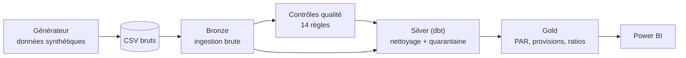

# Plateforme de reporting réglementaire pour institution de microfinance (CEMAC)

Pipeline de données de bout en bout (bronze, silver, gold) avec contrôles qualité mesurés,
sur données **entièrement synthétiques** d'une institution de microfinance de la zone CEMAC.

## Le problème

Dans beaucoup d'institutions de microfinance, les états réglementaires sont produits à la main
à partir du logiciel de gestion et d'Excel : délais longs, écarts entre comptabilité et
portefeuille, rejets, traçabilité quasi nulle. Ce projet montre comment industrialiser cette
chaîne : données contrôlées, anomalies isolées plutôt que supprimées en silence, décisions auditables.

## Architecture



| Couche | Rôle | État |
|---|---|---|
| Générateur | 40 000 clients, 60 000 prêts, 600 000 échéances, 410 000 paiements, épargne, balance mensuelle | Terminé |
| Bronze | Chargement brut dans DuckDB, journal d'ingestion avec empreinte SHA-256 | Terminé |
| Qualité | Catalogue de 14 règles lisibles (`quality/rules.yml`), porte de publication | Terminé |
| Silver | 13 modèles dbt, 33 tests, quarantaine des paiements invalides | Terminé |
| Gold | Portefeuille, PAR 30/90, provisions, concentration, rapprochement comptable | À venir |
| Restitution | Modèle sémantique et tableau de bord Power BI | À venir |

## Démarrage rapide

```bash
git clone https://github.com/UlrichPeme/microfinance-reporting-platform.git
cd microfinance-reporting-platform
python -m venv .venv
source .venv/Scripts/activate      # Git Bash sous Windows ; sous Linux/macOS : source .venv/bin/activate
pip install -r requirements.txt
python pipeline/run_pipeline.py --generate
```

Cette commande génère les données, puis enchaîne bronze, contrôles qualité, silver, tests dbt
et rapport de détection, en moins de 30 secondes.

## Résultats mesurés

Le générateur injecte volontairement 2 825 anomalies et les trace dans un fichier "corrigé".
Les contrôles sont ensuite évalués contre ce corrigé.

- **Détection** : 2 822 anomalies retrouvées sur 2 822 attendues avec la graine par défaut (100 %).
  Sur d'autres graines, le rappel est d'environ 99,9 % : les rares manques sont des doublons de
  clients dont l'original a lui-même été altéré.
- **Faux positifs** : 0, y compris sur un jeu propre généré sans anomalie.
- **Conservation des données** : 412 490 paiements en bronze = 411 666 en silver + 824 en
  quarantaine. 40 240 clients en bronze = 40 000 en silver + 240 doublons retirés.
- **Tests dbt** : 33 sur 33 réussis (unicité, intégrité entre tables, non-perte de lignes).
- **Porte de publication** : bloquée sur le jeu standard (agences inconnues, prêts sans
  échéancier), ouverte sur le jeu propre.

## Choix de conception

- **Rien n'est supprimé en silence.** Les paiements rejetés vont dans `quarantine.quarantine_remboursements`
  avec la règle et le motif ; les valeurs d'origine restent consultables en bronze.
- **Les règles sont des données, pas du code.** Chaque règle porte une dimension, une sévérité,
  une action (quarantaine, correction, dédoublonnage, signalement) et un propriétaire.
- **On ne devine pas.** Un paiement négatif peut être une erreur de signe ou une annulation :
  il est mis en quarantaine pour décision humaine, pas corrigé automatiquement.
- **L'exposition reste visible.** Un prêt à date incohérente est conservé et marqué, car le retirer
  fausserait le rapprochement avec la comptabilité.

## Structure du dépôt

```
data/generator/        générateur de données synthétiques
pipeline/bronze/       ingestion brute
pipeline/dbt_project/  modèles silver et tests dbt
pipeline/run_pipeline.py   orchestrateur
quality/               règles, exécution, évaluation de la détection
docs/                  hypothèses et limites
```

## Limites

Voir [docs/hypotheses_et_limites.md](docs/hypotheses_et_limites.md). En bref : données fictives,
plan comptable simplifié et taux de provisionnement illustratifs, historique démarrant à zéro.

## Stack

Python, DuckDB, dbt (dbt-duckdb), Power BI (à venir).

## Licence

MIT
