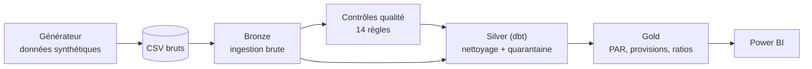

# Plateforme de reporting réglementaire pour institution de microfinance (CEMAC)

Pipeline de données de bout en bout (bronze, silver, gold) avec contrôles qualité mesurés,
sur données **entièrement synthétiques** d'une institution de microfinance de la zone CEMAC.

## Le problème

Dans beaucoup d'institutions de microfinance, les états réglementaires sont produits à la main
à partir du logiciel de gestion et d'Excel : délais longs, écarts entre comptabilité et
portefeuille, rejets, traçabilité quasi nulle. Ce projet montre comment industrialiser cette
chaîne : données contrôlées, anomalies isolées plutôt que supprimées en silence, décisions auditables.

## Architecture



| Couche | Rôle | État |
|---|---|---|
| Générateur | 40 000 clients, 60 000 prêts, 600 000 échéances, 410 000 paiements, épargne, balance mensuelle | Terminé |
| Bronze | Chargement brut dans DuckDB, journal d'ingestion avec empreinte SHA-256 | Terminé |
| Qualité | Catalogue de 14 règles lisibles (`quality/rules.yml`), porte de publication | Terminé |
| Silver | 13 modèles dbt, quarantaine des paiements invalides | Terminé |
| Gold | Encours par prêt, PAR 1/30/90, provisions, concentration, rapprochement portefeuille/comptabilité, décision de publication | Terminé |
| Restitution | Modèle sémantique et tableau de bord Power BI | À venir |

## Démarrage rapide

```bash
git clone https://github.com/duvalpeme/microfinance-reporting-platform.git
cd microfinance-reporting-platform
python -m venv .venv
source .venv/Scripts/activate      # Git Bash sous Windows ; sous Linux/macOS : source .venv/bin/activate
pip install -r requirements.txt
python pipeline/run_pipeline.py --generate
```

Cette commande génère les données, puis enchaîne bronze, contrôles qualité, silver, gold, tests dbt
et rapport de détection, en moins de 30 secondes. Pour lire les résultats de la couche gold :

```bash
python pipeline/apercu_gold.py
```

## Résultats mesurés

Le générateur injecte volontairement 2 825 anomalies et les trace dans un fichier "corrigé".
Les contrôles sont ensuite évalués contre ce corrigé.

- **Détection** : 2 825 anomalies retrouvées sur 2 825 injectées avec la graine par défaut (100 %),
  rapprochement comptable compris. Sur d'autres graines, le rappel des règles qualité est d'environ 99,9 %.
- **Faux positifs** : 0 sur le jeu standard, et 0 sur un jeu propre généré sans anomalie.
- **Conservation des données** : 412 490 paiements en bronze = 411 666 en silver + 824 en
  quarantaine. 40 240 clients en bronze = 40 000 en silver + 240 doublons retirés.
- **Rapprochement portefeuille / comptabilité** : l'écart brut de -21,5 M FCFA à l'arrêté est entièrement
  expliqué par les paiements en quarantaine (27,8 M) et le compte d'attente (6,4 M) : **écart non expliqué
  de 0 FCFA**. Les deux agences où un écart a été injectées sont les seules signalées. Sur un jeu propre,
  l'écart est de 0 FCFA à chaque date.
- **PAR 30 de 7,44 %**, dont 0,36 point potentiellement artificiel : des paiements en quarantaine font
  apparaître des échéances impayées à tort (PAR 30 hors retards incertains : 7,08 %).
- **Tests dbt** : 58 sur 58 réussis (unicité, intégrité, non-perte de lignes, invariants de la couche gold).
- **Porte de publication** : bloquée sur le jeu standard (agences inconnues, prêts sans échéancier,
  écarts de rapprochement), ouverte sur le jeu propre.

### Limites mesurées du rapprochement

Sur cinq graines aléatoires, 14 écarts injectés sur 15 sont signalés fermement, le quinzième l'est avec
la réserve INCERTAIN, et une agence est signalée à tort. Les deux causes sont identifiées et documentées
dans [docs/hypotheses_et_limites.md](docs/hypotheses_et_limites.md) : l'agence d'un client peut être
irrécupérable, et la date de certains prêts n'est pas fiable. Le seuil de matérialité (0,5 % de l'encours
d'une agence) n'a volontairement pas été ajusté pour effacer ces cas.

## Choix de conception

- **Rien n'est supprimé en silence.** Les paiements rejetés vont dans `quarantine.quarantine_remboursements`
  avec la règle et le motif ; les valeurs d'origine restent consultables en bronze.
- **Les règles sont des données, pas du code.** Chaque règle porte une dimension, une sévérité,
  une action (quarantaine, correction, dédoublonnage, signalement) et un propriétaire.
- **On ne devine pas.** Un paiement négatif peut être une erreur de signe ou une annulation :
  il est mis en quarantaine pour décision humaine, pas corrigé automatiquement.
- **L'exposition reste visible.** Un prêt à date incohérente est conservé et marqué, car le retirer
  fausserait le rapprochement avec la comptabilité.

## Structure du dépôt

```
data/generator/        générateur de données synthétiques
pipeline/bronze/       ingestion brute
pipeline/dbt_project/  modèles silver et gold, tests dbt
pipeline/run_pipeline.py   orchestrateur
pipeline/apercu_gold.py    lecture des résultats de la couche gold
quality/               règles, exécution, évaluation de la détection
docs/                  hypothèses et limites
```

## Limites

Voir [docs/hypotheses_et_limites.md](docs/hypotheses_et_limites.md). En bref : données fictives,
plan comptable simplifié et taux de provisionnement illustratifs, historique démarrant à zéro.

## Stack

Python, DuckDB, dbt (dbt-duckdb), Power BI (à venir).

## Licence

MIT
